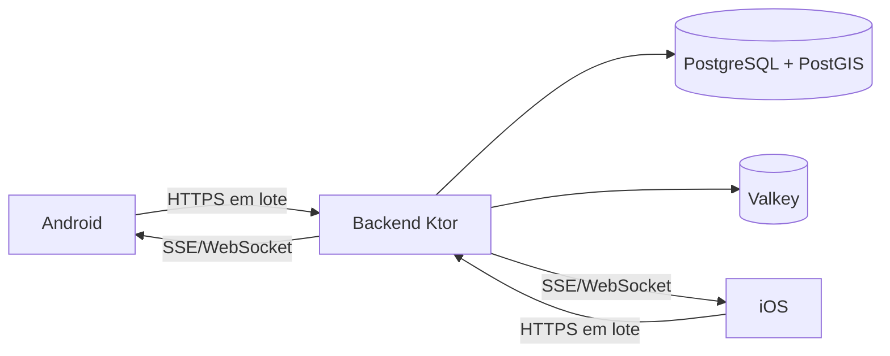
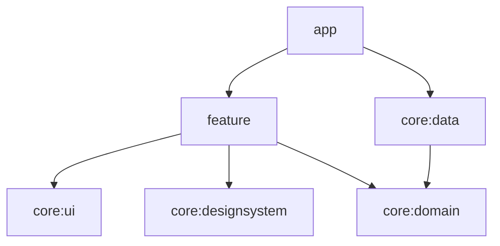

# Arquitetura

Contratos em `contracts/`. Backend em AWS sa-east-1 (Fargate + RDS PostGIS).

## Decisões
- Telemetria anônima, partições por hora, retenção de 24 h.
- Identidade por @handle; telefone e e-mail ocultos.
- Ingestão por HTTPS em lote. Compartilhar viagem só depois da V1.

## Apps
Clean Architecture com MVVM/MVI. Os módulos das duas plataformas se espelham:

Android: `:app`, `:core:{ui,designsystem,data,domain}`, `:feature:{auth,trains,stations,tracking,alerts,privacy,onboarding,achievements,widgets}`.
iOS: targets equivalentes em `MalhaVivaKit` (`DomainLayer`, `DataLayer`, `DesignSystem`, `CoreUI`, `Feature*`).
